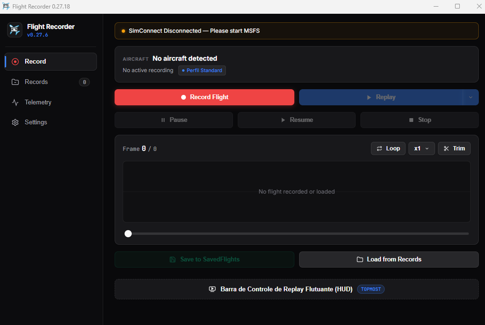
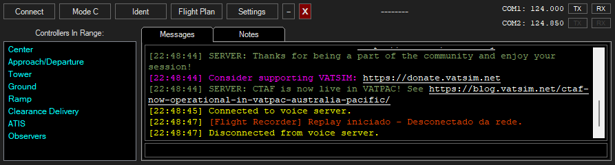

# ✈️ Flight Recorder

[](https://github.com/GordelaG/Flight-Recorder/releases)
[](https://dotnet.microsoft.com/)
[](https://www.flightsimulator.com/)
[-18181b?logo=tailwindcss)](https://fluxui.dev)
[](LICENSE)

**Flight Recorder** é um gravador e reprodutor de voo de alta precisão para o **Microsoft Flight Simulator (MSFS 2020 & 2024)**. Desenvolvido com interface moderna inspirada no **[Flux UI](https://fluxui.dev)**, o aplicativo oferece controle total sobre gravações de voo, barra flutuante (HUD) para usar durante a pilotagem, gravação automática por altitude, telemetria em tempo real e biblioteca de voos salvos.

---

## 📸 Interface do Aplicativo



---

## 🌟 Principais Recursos

### 🎨 Interface Moderna Flux UI
- Design limpo e profissional baseado na paleta Zinc do **Flux UI** (`#09090b`, `#18181b`, `#27272a`).
- Modos **Escuro (Dark)**, **Claro (Light)** ou sincronizado com as preferências do Windows.
- Diálogos modais de confirmação 100% customizados (`FluxConfirmDialog`), eliminando completamente as caixas de mensagens legadas do Windows.
- Barras de rolagem em formato de cápsula com transições suaves (`lux-scrollbar`).

### 📼 Gravação e Replay de Alta Fidelidade
- **Captura Completa:** Grava cada quadro de dados via **SimConnect** (posição 3D, latitude, longitude, altitude, pitch, bank, heading, superfícies aerodinâmicas, profundores, ailerons, leme, flaps, spoilers, trem de pouso, reversores, throttles e luzes).
- **Replay Suave:** Congelamento dinâmico do simulador para evitar conflitos de física e proporcionar uma reprodução idêntica ao voo real.
- **Velocidade Variável:** Acelere ou reduza a velocidade da reprodução (**0.25x**, **0.5x**, **1x**, **2x**, **4x**, etc.).
- **Modo Loop:** Repita aproximações e pousos continuamente para treinamento ou gravação de vídeos cinematográficos.
- **Ferramenta de Corte (Trim):** Corte o início (*Trim Start*) ou o final (*Trim End*) do voo diretamente na linha do tempo para salvar apenas o momento desejado.

### 🎛️ Barra Flutuante de Controle de Replay (HUD Always-On-Top)
- Mini player transparente e compacto que fica sempre no topo (**Topmost**), flutuando sobre o simulador.
- Controle direto de **Play/Pause**, **Stop Replay**, **Loop** e **Slider de Linha do Tempo** com contador de tempo decorrido.
- **Botão de Gravação Rápida no HUD:** Inicie e pare gravações diretamente pela barra sem precisar alternar para a janela principal.
- Alternância rápida via atalho global do teclado configurável.

### 🛩️ Gravação Automática por Altitude (Auto-Record)
- **Totalmente Configurável:** Ajuste a altitude limite de disparo entre **1.000 e 15.000 pés** diretamente na aba de configurações (padrão de fábrica: **6.000 pés**), com slider visual e botões de atalho rápido (**3.000 ft**, **6.000 ft**, **10.000 ft**).
- **Disparo em Descida:** Inicia a gravação automaticamente assim que o aplicativo estiver aberto e a aeronave cruzar a altitude configurada (ideal para registrar aproximações e pousos sem intervenção manual).
- **Proteção por Histerese:** Algoritmo com margem de segurança para prevenir disparos repetidos ou falsos durante nivelamentos e turbulências.
- Ativado por padrão com chave seletora (*toggle switch*) para ligar/desligar com 1 clique.

### 📁 Gerenciador de Voos Salvos (SavedFlights)
- Salve gravações diretamente no armazenamento local com um clique no botão **Save to SavedFlights**.
- Painel **Records** com cards detalhados:
  - Título e identificador da aeronave.
  - Data e hora de criação.
  - Duração total formatada.
  - Quantidade de frames e tamanho do arquivo.
  - Perfil de integração ativo.
- Pesquisa instantânea por nome da aeronave ou arquivo.
- Estatísticas de gravações: total de voos catalogados e tempo total registrado.
- Botões para carregar voos diretamente para o Replay, exclusão com modal de confirmação e acesso rápido à pasta do Windows.
- Importação e exportação de gravações nos formatos `.fltrec` e `.flightrecorder`.

### 📊 Painel de Telemetria e Instrumentos ao Vivo
- Monitoramento em tempo real dos parâmetros da aeronave conectada via SimConnect:
  - **Fase de Voo:** Indicadores dinâmicos `GROUND (GND)` ou `AIRBORNE (AIR)`.
  - **Coordenadas:** Latitude e Longitude com botão de cópia rápida para a área de transferência.
  - **Atitude:** Pitch, Bank e Proa (True / Magnetic Heading).
  - **Superfícies e Trem:** Status do trem de pouso (`DOWN` / `UP`) e posição das manetes de potência (Throttle).
  - **Taxa de Toque (Landing Rate):** Medição precisa da razão de descida no instante exato do toque na pista (em pés por minuto / FPM).
  - **Gráfico Interativo:** Visualização das curvas de altitude e velocidade ao longo de toda a gravação.

### ⌨️ Atalhos Globais de Teclado (Global Hotkeys)
- Controle o aplicativo mesmo com o Microsoft Flight Simulator em foco ou em tela cheia.
- Editor interativo de atalhos com detecção ao vivo dos modificadores (<kbd>Ctrl</kbd>, <kbd>Alt</kbd>, <kbd>Shift</kbd>).
- Atalhos padrão de fábrica:

| Ação | Atalho Padrão | Descrição |
|---|---|---|
| **Gravar Voo** | <kbd>Ctrl</kbd> + <kbd>Shift</kbd> + <kbd>Alt</kbd> + <kbd>Home</kbd> | Inicia uma nova gravação |
| **Parar Gravação** | <kbd>Ctrl</kbd> + <kbd>Shift</kbd> + <kbd>Alt</kbd> + <kbd>End</kbd> | Interrompe a gravação em andamento |
| **Iniciar Replay** | <kbd>Ctrl</kbd> + <kbd>Shift</kbd> + <kbd>Alt</kbd> + <kbd>R</kbd> | Inicia a reprodução do voo gravado |
| **Pausar / Resumir** | <kbd>Ctrl</kbd> + <kbd>Shift</kbd> + <kbd>Alt</kbd> + <kbd>,</kbd> | Alterna a pausa da reprodução |
| **Parar Replay** | <kbd>Ctrl</kbd> + <kbd>Shift</kbd> + <kbd>Alt</kbd> + <kbd>S</kbd> | Encerra a reprodução e libera a aeronave |
| **Barra de Replay (HUD)** | <kbd>Ctrl</kbd> + <kbd>Shift</kbd> + <kbd>Alt</kbd> + <kbd>H</kbd> | Abre / fecha a barra flutuante |

### 🛡️ Proteção Contra Falhas (Auto-Save & Crash Recovery)
- Mecanismo em segundo plano que salva o progresso contínuo da gravação.
- Em caso de queda de energia ou fechamento involuntário, o aplicativo identifica os dados na inicialização e oferece restauração com 1 clique.

### 🌐 Integração vPilot / VATSIM
- **Desconexão Automática Preventiva:** Ao iniciar um Replay ou acionar o Resume, o Flight Recorder comunica-se via Named Pipe diretamente com o plugin integrado do vPilot para desconectar sua aeronave da rede VATSIM de forma limpa e automática, evitando conflitos de física, "teletransportes" ou advertências de controladores de tráfego aéreo.
- **Notificação no Chat do vPilot:** Exibe uma notificação personalizada no painel *Messages* com a cor oficial do aplicativo (`#EE4203`) e carimbo de data/hora UTC nativo:
  ```
  [HH:mm:ss] [Flight Recorder] Replay started - Disconnected from network.
  ```
- **100% Local e Privado:** A notificação é renderizada exclusivamente na janela do seu vPilot local, sem qualquer transmissão de pacotes ou mensagens pela frequência de rádio da rede.



### 🌍 Suporte Multilíngue (i18n)
- Disponível nativamente em **Português (pt-BR)**, **Inglês (en)**, **Espanhol (es)** e **Francês (fr)**.
- Seletor rápido de idiomas no cabeçalho com persistência automática da preferência do usuário.
- Arquitetura modular e extensível (`locales/*.js`) para fácil adição de novas traduções.

### 📈 Exportação Avançada
- **Exportar para CSV:** Ideal para análise pós-voo em softwares como Excel ou Google Sheets.
- **Exportar para KML:** Visualize o caminho 3D percorrido pelo avião diretamente no **Google Earth**.

---

## 🚀 Instalação e Requisitos

### Requisitos Mínimos
- **Sistema Operacional:** Windows 10 ou Windows 11 (64 bits).
- **Simulador:** Microsoft Flight Simulator 2020 ou Microsoft Flight Simulator 2024.
- **Ambiente de Execução:** [.NET 8.0 Desktop Runtime](https://dotnet.microsoft.com/download/dotnet/8.0) (x64) e [Microsoft Edge WebView2 Runtime](https://developer.microsoft.com/microsoft-edge/webview2/) (já incluso na maioria das versões do Windows 10/11).

### Como Usar
1. Baixe a versão mais recente em [Releases](https://github.com/GordelaG/Flight-Recorder/releases).
2. Extraia o arquivo `.zip` em uma pasta de sua preferência.
3. Inicie o Microsoft Flight Simulator e carregue seu voo na pista ou pátio.
4. Execute `FlightRecorder.Client.exe`. O indicador do SimConnect ficará verde automaticamente assim que a conexão for estabelecida.
5. Clique em **Record Flight** (ou utilize o atalho de teclado / barra flutuante HUD) para começar a gravar.
6. Ao finalizar, clique em **Stop** e depois em **Replay** para assistir ou **Save to SavedFlights** para catalogar seu voo.

---

## 🛠️ Tecnologias Utilizadas

- **C# / .NET 8.0:** Núcleo de alta performance e baixa latência.
- **SimConnect SDK:** Comunicação nativa com o motor do Microsoft Flight Simulator.
- **WPF + Microsoft WebView2:** Renderização da interface com tecnologia web moderna aliada ao controle do Windows.
- **Design System:** [Flux UI](https://fluxui.dev) com arquitetura responsiva e tokens Tailwind Zinc.

---

## 🤝 Contribuições & Suporte

Contribuições são bem-vindas! Sinta-se à vontade para abrir uma [Issue](https://github.com/GordelaG/Flight-Recorder/issues) para relatar problemas ou sugerir novos recursos, bem como enviar um [Pull Request](https://github.com/GordelaG/Flight-Recorder/pulls).

---

## 📄 Licença

Distribuído sob a licença **MIT**. Consulte o arquivo [LICENSE](LICENSE) para obter mais informações.